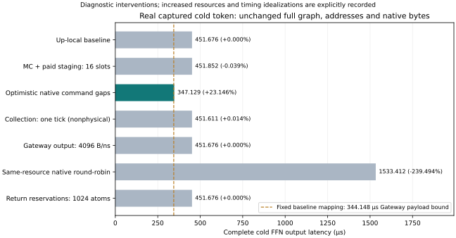
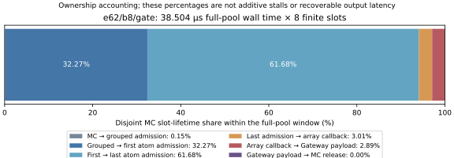

# Cold Gate: native service, return paths and finite state

**结论：在已发表的真实 cold token 上，当前主要性能机会指向原生命令服务间隔。扩大 MC、Gateway 出口或返回容量没有产生收益；仅缩短 collection 传播也几乎无效。** 这是受控诊断结果，尚未证明更多 DRAM domains 的等成本可制造性或新架构的必要性。

## 执行范围与身份

在 hn072 执行七个完整 cold FFN，使用原始 Qwen3 capture
`mmlu/abstract_algebra/98.json` 的 layer 0、zero-based decode step 16，
ranked experts 为 `[36,10,23,108,62,67,109,50]`。保持 hidden=4096、
intermediate=1536、完整矩阵和全部任务，没有缩小尺寸或替换为 synthetic
routing。原始 routing 身份由完整 corpus 的独立覆盖审计验证。

**本结果只覆盖一个真实 cold token。** 完整 prefill/decode request 的独立回放
`full-request-r2` 仍在运行，本报告不把单 token 结果推广为完整 trace、94-layer
Transformer 或数值推理结果。状态快照记录第一原始请求、真实 layers 0/1、
全部 46 prefill / 128 decode tokens；其中还没有完成的应用时序结果。

执行源码 `565f148`，独立 reader `0e5a8d4`。七项使用相同冻结的
Ramulator bridge / BookSim。每项均实际读取 **151,031,808 B**；已发出的
请求地址 multiset、每个 native domain 的 atom 数、每个 Gateway 的数据量和
MAC 工作相同。新 baseline 与原 `02dab2a` Up-local 的**完整物理记录一致**。
六项定向资源/时间线检查通过，七项完整应用与保存结果独立审计通过，回收后
24 个证据文件的 SHA-256 再次一致。没有以性能为条件筛选或重跑应用。

协议：[COLD_MEMORY_CAUSALITY_PROTOCOL](COLD_MEMORY_CAUSALITY_PROTOCOL.md)。
权威结果：[independent-readback.json](../../artifacts/provenance/cold_memory_causality/native-study/independent-readback.json)。

## 测量到的干预效果

正数表示整层延迟减少；负数表示退化。单位为 µs。

| 干预 | 完整 cold FFN | 延迟减少 | 相对减少 |
|---|---:|---:|---:|
| Up-local baseline | 451.676 | 0 | 0% |
| MC 8 → 16，并支付相应 staging/control credits | 451.852 | −0.176 | −0.0390% |
| 原生 row/CAS/refresh 命令间隔理想化 | **347.129** | **104.547** | **23.1465%** |
| 仅 collection 数据传播 → 一个 3.76 ns 周期 | 451.611 | 0.065 | 0.0144% |
| Gateway payload output 32 → 4096 B/ns | 451.676 | 0 | 0% |
| 等资源 native descriptor round-robin | 1533.412 | −1081.736 | −239.4938% |
| 每 domain 返回预留 64 → 1024 atoms | 451.676 | 0 | 0% |

原生间隔干预仍由真实 Ramulator 发出命令，保留 128 controllers、nBL=1、
3.76 ns 原生数据总线、nREFI=1037 及有限 read queues。它同时放宽 row/CAS
和 refresh 间隔，**尚未分离哪类命令间隔贡献最大**，也没有增加原生总线速率。
347.129 µs 不是可制造 DRAM、新架构或 silicon 校准性能。

Gateway 干预保留真实 BookSim/RX，**没有测量完全理想 NoC 的上界**。
MC16 同时增加 grouped descriptor slots、返回 staging 与控制 credit 资源，
不能解释成零成本增加八个计数器。Collection 干预故意违反物理 wire timing，
只改变数据传播，原命令/ACK 路径保持真实。

Round-robin 的负结果说明现有 row-batched 服务策略必须进入强基线；
它没有排除所有可能的软件调度或数据布局。

## 38.504 µs MC 满载的实际所有权

在 `e62/b8/gate` 的实际 descriptor issue window 内，`pool0_3` 的八个槽位
满载 38.504 µs；独立 native grouped pool 满载 38.05168 µs。六个互斥的
slot-lifetime 阶段严格守恒为 `8 × 38.504 µs`：

| 槽位阶段 | 满载窗口内 slot-time 占比 |
|---|---:|
| MC accept → grouped native admission | 0.1468% |
| Grouped admission → first atom admission | 32.2738% |
| First → last atom admission | 61.6804% |
| Last atom admission → last array callback | 3.0107% |
| Last array callback → Gateway payload | 2.8882% |
| Gateway payload → MC release | **0%** |

**93.9542% 的槽位占用在最后一个 atom 被原生控制器接纳之前。** 所有权只来自
目标 Gate 和同一 Gateway 的 `e109/b11/down`，后者占窗口 slot-time 的约
51.11%。这不是 93.95% 的端到端 stall，更不能换算成独立可恢复的延迟。
Atom 接纳区间重叠 DRAM 执行、队列选择和返回。

原始数组事件标记表示最后一个 native bus cycle 的起点；reader 加上该 domain
的实际 period 后才得到 callback/collection origin。`native_ready` 表示 Gateway
payload 可用，不是 array read 结束。逐请求 issue、MC accept、grouped admission、
每 domain first/last atom admission、callback、payload、MC release 和 operand
commit 的完整派生记录保存在
[historical-lifetimes.json.gz](../../artifacts/provenance/cold_memory_causality/historical-lifetimes.json.gz)，
并绑定历史 raw SHA 与真实 capture SHA。

基线 native return-reservation stall attempts 为 **0**。放宽返回容量不改变
完成时间，与这个观察一致。Gateway output relaxation 不改变完成时间；
MC16 虽把固定 Gate 的 full-window 缩短至 37.530 µs，整层却更慢。这些干预
共同反驳将 MC-full 直接解释成缺 buffer 或缺出口吞吐的做法。

原生间隔理想化之后，return-reservation stall attempts 增为 **405,788**。
它是反复尝试计数，不是 stall 时间；但表明提高原生服务后，当前返回资源已
开始阻止接纳。今天没有收益的返回容量，不能被推断为在更快 DRAM 下也无用。

## 关键路径变化与更紧的下界

| 固定 `e62/b8/gate` 边界 | Baseline | Native-gap diagnostic | 提前/缩短 |
|---|---:|---:|---:|
| Compute start | 388.278 | 298.541 | 89.737 |
| Finish | 427.180 | 327.961 | 99.219 |
| Start → finish | 38.902 | 29.420 | 9.482 |

整层减少 104.547 µs，固定 Gate 提前 99.219 µs，但其自身 context 仅缩短
9.482 µs。上游依赖和共享服务的更早进度贡献了主要时间变化。
不能将这一结果描述为移除了最后一个 Gate 的 38.504 µs MC 等待。
Receipt 同时保存三组 matched Gate blocks 与各运行真正最晚完成的 Gate。

总数据量除以 512 GB/s 给出的 294.984 µs 只是全局必要下界。
**保持当前地址分布时**，最忙 Gateway 读取 11,012,736 B，其工作下界为

\[
T\geq11,012,736/(32\times10^9)=344.148\ \mu s.
\]

最忙 native domain 读取 1,376,608 B，接口工作下界为 323.50288 µs。
于是当前映射与速率下的乐观延迟减少上限是 **23.8064%**，比全局 35% 更紧。
Native-gap diagnostic 达到 347.129 µs，仅高于固定 Gateway 下界 2.981 µs。
这些是忽略 command gaps、refresh、依赖与 drain 的 payload 必要界，不是可达性能。
改动数据布局会改变端点工作分布，因此不能把这个固定映射界推广到所有布局。

## 研究决定

本轮停止把扩大 Fetch/MC、缩短 collection 传播或加宽当前 Gateway 当作
主要 cold latency 路线。优先校准原生 array/refresh 时序，并分别测量 row/CAS
与 refresh 间隔，随后才探索真实的独立服务域及其接口组织。

当前证据支持**把原生服务作为下一阶段问题**，不支持直接宣布 256×32 MiB
等面积可行，也没有证明新增端点、compute-near-memory 或原生并行度不能
由更好的数据组织/调度等价实现。更快的原生服务会暴露新的返回/出口限制，
后续设计需要同步计入 HB、Gateway、有限返回和布局成本。

完整 captured-request 的 prefill/decode、有限 SRAM、真实专家热度变化仍是
推广这些判断的必要后续验证。本轮没有新数值推理、PPA/能耗校准或热结论。

## 可复核材料

- [冻结注册](../../artifacts/provenance/cold_memory_causality/native-study/registration.json)、[运行命令与 PID](../../artifacts/provenance/cold_memory_causality/native-study/launch.json)
- [独立审计与 raw SHA](../../artifacts/provenance/cold_memory_causality/native-study/independent-readback.json)、[回收 SHA 清单](../../artifacts/provenance/cold_memory_causality/native-study/manifest.json)
- [六项检查](../../artifacts/provenance/cold_memory_causality/native-study/tests.log)、[独立 reader 完成日志](../../artifacts/provenance/cold_memory_causality/native-study/logs/readback-monitor.log)
- [完整 request 的独立状态快照](../../artifacts/provenance/cold_memory_causality/native-study/complete-request-status-snapshot.json)

Raw captures / 原生工具保留在 hn072 的隔离目录
`/Projects/haoning/w2w-full-system-memory-causality-20261011/cold-gate-sol-r1`，
没有进入 Git。源代码、应用输入生成器、干预资源账本及独立 reader 都在本仓库。
