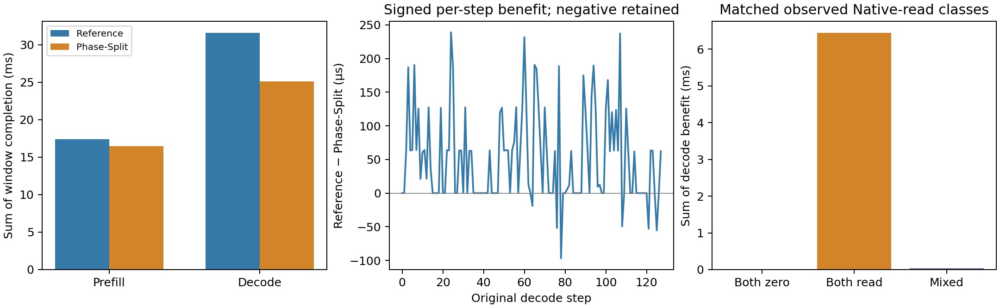
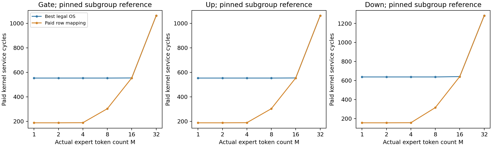
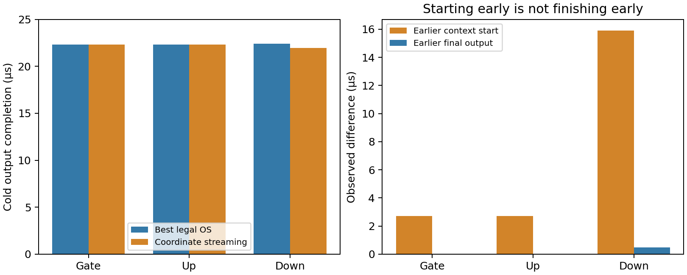
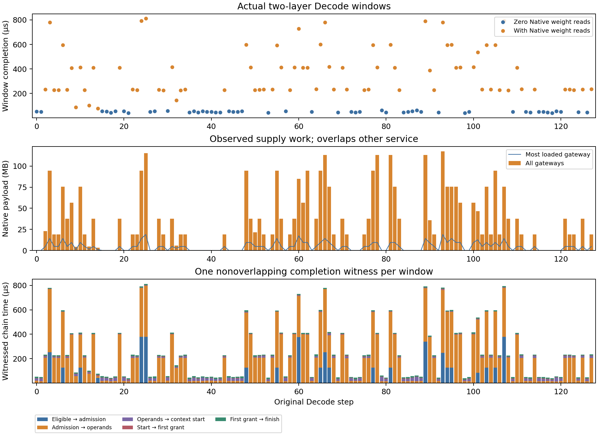
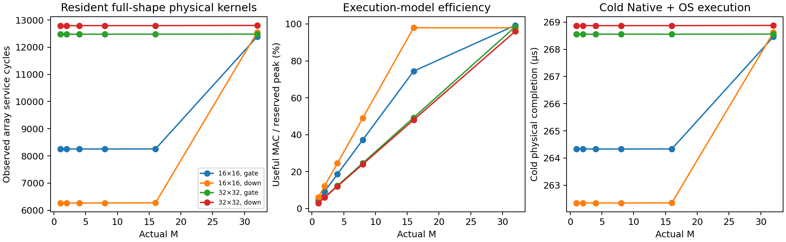
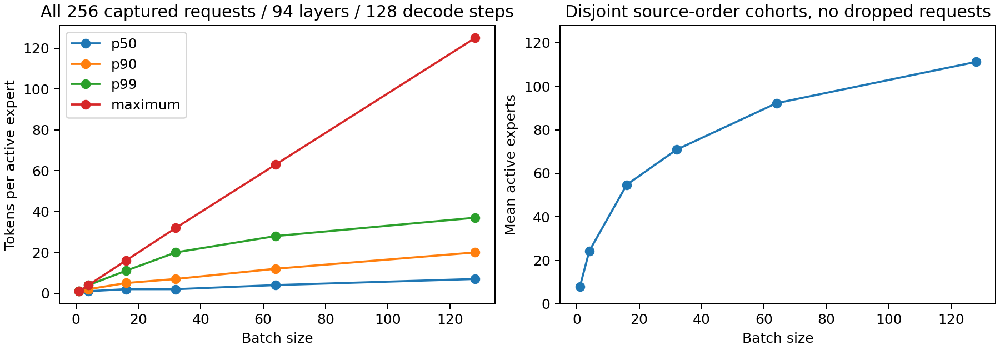
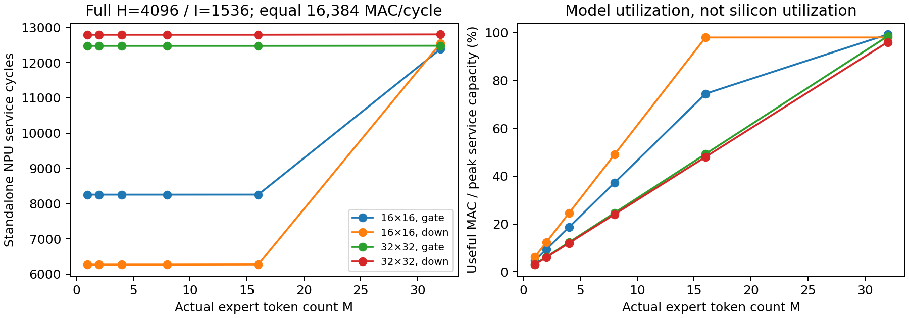
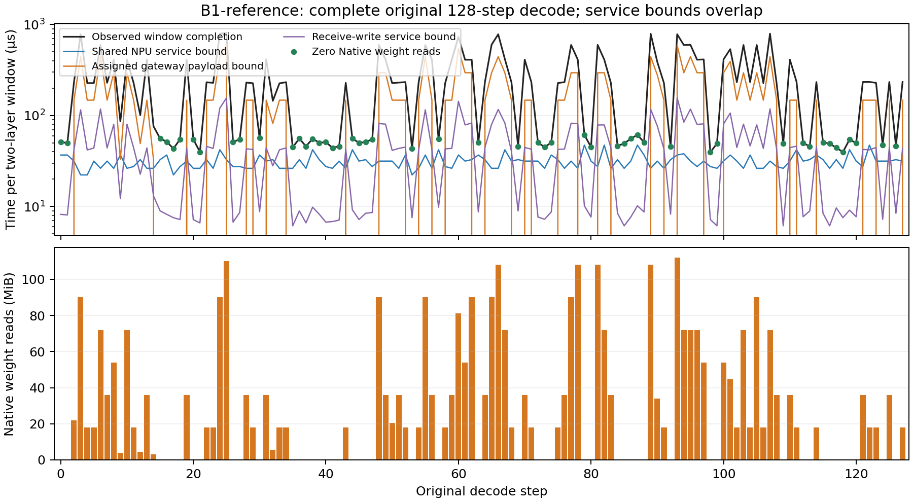

# Real MoE → executable WoW NPU: evidence and remaining gates

The accepted foundation executes actual expert token shapes on a concrete,
finite NPU array model. **The complete B1 G3 scope is now independently
accepted:** both Reference and Phase-Split, the sharded legality qualification,
130-window phase mechanisms and paired physical/resource/carry audits.
The latest authorized continuation is explanation → resident row mapping →
independent streaming → real B4/16/32 validation. New interventions use isolated
versions and leave the original B1 evidence immutable. The old broad campaign
and G4/G5 remain held. A launched job or compiler view is not acceptance.

## Current B1 scope and event mechanisms

[The scope-freeze receipt](../../artifacts/provenance/real_npu/scope-freeze-B1-r45.json)
records a reversible hold on only the old future-launch/readback controllers
826834, 826982 and 832174. The existing physical Phase-Split worker 888240
completed at its immutable `source-r27@a69d29e`; registration, machine, kernel,
Native binaries and cache budgets are unchanged. The old controllers are not
resumed. Newly authorized P3 runs are separately registered conditional episodes;
historical scheduling descriptions below remain superseded by this scope.

| Gate | Current evidence |
|---|---|
| G3.1 | Complete B1 Reference, full physical/resource audit accepted |
| G3.2 | Same-trace B1 Phase-Split physical replay complete and independently accepted |
| G3.3 | Already launched output-sharded qualification complete; independent full-window legality readback accepted |
| G3.4 | All 130 windows per placement reconstructed; signed phase/cache pairing complete |
| G3.5 | Full Native/NoC/SRAM/cache/NPU and continuous carry audits accepted for the scoped B1 pair |

[The G3 acceptance receipt](../../artifacts/provenance/real_npu/B1-g3-complete-r51.json)
binds the complete physical analysis, existing kernel/shard qualification and
[all signed window comparisons](../../artifacts/provenance/real_npu/B1-paired-mechanism-r51.json).

| Observed completion | Reference | Phase-Split | Completion reduction |
|---|---:|---:|---:|
| Prefill, 46 tokens / 2 windows | 17.373712 ms | 16.474599 ms | 5.18% |
| Decode, 128 windows | 31.569973 ms | 25.089160 ms | **20.53%** |
| Complete two-layer episode, including inter-window drain | 48.948846 ms | 41.568920 ms | 15.08% |

The Decode benefit is **6.480813 ms**. All **51 both-zero-Native** steps have
exactly equal completion times; **76 both-reading** steps contribute
**6.444848 ms**, and one mixed-reading step contributes **35.965 µs**.
Across all Decode steps, 70 improve, seven regress, and 51 are unchanged.
The regressions are steps 32/64/76/78/108/121/125; step 78 regresses by
96.886 µs. The first Prefill window also regresses (9.713503 → 10.899564 ms),
despite the aggregate Prefill improvement. No negative sample is discarded.

These matched observations locate the benefit in Native-supply episodes.
Phase-Split changes physical placement and the resulting supply/cache timing;
the result alone does not isolate Gateway parallelism from cache lifecycle,
Activation arrival or compute contention. The saved-event P1 reader separates
those observed boundaries before P2 physical comparisons start. This remains
the complete captured **two-layer MoE** episode, not full Qwen TTFT/TPOT.

### Accepted P1: where the Decode benefit appears

[The P1 source readback](../../artifacts/provenance/real_npu/B1-benefit-sources-r59.json)
and [its acceptance receipt](../../artifacts/provenance/real_npu/B1-benefit-sources-receipt-r59.json)
inspect all 260 unchanged saved windows, separating original weight delivery,
Packed-X/tensor delivery and compute-context/array grants.

| Observed Decode quantity | Reference | Phase-Split |
|---|---:|---:|
| Native payload | 3,671,960,832 B | 3,673,534,080 B |
| Reload payload | 3,011,196,672 B | 3,012,769,920 B |
| Sum of busiest-Gateway payload work bounds per step | 17.633488 ms | 13.438160 ms |
| Completion-witness operand interval with Native last-ready | 22.462969 ms | 17.442506 ms |
| Completion-witness operand interval with Activation last-ready | 1.721172 ms | 1.720783 ms |
| Miss Fetch Context hold P50 / P99 | 42.737 / 43.027 µs | 21.899 / 77.142 µs |
| NoC payload-distance activity | 2.36043475456e13 B·µm | 4.05689190656e13 B·µm |

Decode reads **1,573,248 B more**, so its benefit is not saved weight traffic.
The same aggregate MAC and array-service work is preserved. Placement reduces
concentrated necessary Gateway work and typical miss lifetimes, while increasing
NoC movement and the tail of miss lifetimes. Gateway bounds are per-window
necessary service work, not independently removable delays or a predicted sum.

The signed completion-witness differences are 1.412414 ms at admission,
5.020852 ms at operand readiness, 0.011738 ms at context start, 0.034772 ms at
first grant and 0.001037 ms through completion. Their sum is the exact
6.480813 ms Decode benefit. These are different observed witness positions,
not five separately identified causes. The Native-last-ready reduction is
5.020463 ms; Activation-last-ready changes by only 0.389 µs.

Step 24 improves by 238.877 µs with **identical Native and Reload bytes**, a
98.328 µs smaller busiest-Gateway work bound, 129.664 µs less witnessed
admission time and 109.307 µs less operand time. Step 78 instead regresses
96.886 µs with identical reads: its Gateway bound is 49.164 µs smaller, but
witnessed operand time is 100.470 µs longer. NoC activity increases in both.
Thus the useful conclusion is improved effective supply/competition under this
placement, with real transport/tail tradeoffs; it is not a pure bandwidth or
cache-hit-rate claim. [Every signed step is retained](../../artifacts/provenance/real_npu/B1-benefit-steps-r59.csv).

### Accepted P2-A: resident intra-array row mapping

[The independent reference](../../artifacts/provenance/real_npu/P2A-row-mapping-reference-r64.json)
qualifies 54 combinations of M=1/2/4/8/16/32, Gate/Up/Down and reference OS /
best legal OS / adaptive paid row mapping. Each subgroup core matches pinned
SCALE-Sim, and actual coordinate/increasing-K FP32 partials match an independent
synthetic BF16 × scaled FP8 GEMM. Maximum relative L2 error is 4.432e−7 and
normalized maximum error 5.934e−7, below the registered 1e−4 tolerances.

[Nine resident Native fixtures](../../artifacts/provenance/real_npu/P2A-resident-row-mapping-r64.json)
use the actual lowered full-size M1 matrices, paid initial cache residency,
input DMA and the shared physical executor. All Native, NoC, SRAM, cache and
NPU audits pass. The strongest OS baseline searches every legal aligned K
partition; its M1 result happens to equal the original reference.

| M1 kernel | Best OS service | Paid row service | Best OS output | Row output |
|---|---:|---:|---:|---:|
| Gate / Up, 1×128×4096 | 553 cycles | **188 cycles** | 0.619 µs | **0.254 µs** |
| Down, 1×4096×128 | 637 cycles | **155 cycles** | 0.641 µs | **0.159 µs** |

Aggregate compute remains 16,384 MAC/cycle, with the original SRAM/cache/port,
bank/fanout, Native and NoC budgets. Four 4×16 row groups use K folding for
Gate/Up and N folding for Down; larger M can fall back to the strongest OS.
Configuration construction/read/latch, original scale load plus internal scale
routing, extra word buffers and FP32 reductions are paid. M1 scratch increases
from 137,216 / 149,504 B to **257,024 B**. Independent row weight lanes increase
from 1,024 to 4,096; those extra steering/injection capabilities are explicit
candidate hardware, with uncalibrated wire/mux area and energy. This proves
declared-model feasibility and earlier fixture output, not equal-area silicon
or whole-request speedup.

[Six additional cycle/epoch Native comparisons](../../artifacts/provenance/real_npu/row-cycle-epoch-equivalence-r66.json)
execute three resident matrices in one cluster with only two compute contexts,
for each projection kind. Individual paid row instructions pass the actual
cycle ledger; compact epochs preserve every other physical event, resource and
output timestamp. Gate/Up's three-matrix completion is 0.630 µs and Down's
0.469 µs in both representations. Thus the result is qualified physical
execution under queued contexts, with explicit per-cycle work, not an arbitrary
compiler latency label.

The first opt-in r63 physical audit rejected internal scale rereads as duplicate
source scale consumption. [Its failed status is retained](../../artifacts/provenance/real_npu/ordered-r63-failed-audit.json).
r64 separates source payload from paid internal service and allows coordinate
streaming only after its independent readiness/work/owner proof. Defaults and
the frozen B1 evidence are unchanged. Fourteen directed checks plus
[three existing Native cache/context regressions](../../artifacts/provenance/real_npu/default-native-regression-r64.json)
pass. Later failures preserve completed raw captures before auditing.

### Accepted P2-B: independent coordinate streaming

[The streaming receipt](../../artifacts/provenance/real_npu/P2B-coordinate-streaming-r64.json)
compares the same strongest OS with complete operands versus paid coordinate
probes under the original row-major, Scale-first 524,416 B supply. There is no
row folding. Full inputs and original scales must be ready; individual weight
words require their actual committed descriptors. Table construction, ROM/state
and probes are charged; miss Context release and full cache pins stay unchanged.

| Cold M1 kernel | Complete-operand output | Streaming output | Earlier start | Earlier output |
|---|---:|---:|---:|---:|
| Gate / Up | 22.325 µs | 22.310 µs | 2.714 µs | **0.015 µs** |
| Down | 22.409 µs | 21.932 µs | 15.910 µs | **0.477 µs** |

Earlier acquisition mostly becomes retained-array operand wait: 2,682 cycles
for Gate/Up and 15,428 for Down. The historical aggregate `StreamGemm` is also
retained, explicitly unqualified for shape/array mapping. It is not promoted
to a stronger real-array implementation. The actual cold→warm boundary passes
all carry/resource checks; warm Gate pays 570 service cycles versus OS's 553.

[The host-index equivalence proof](../../artifacts/provenance/real_npu/host-admission-index-equivalence-r64.json)
checks three cold matrices competing for two Fetch Contexts, followed by three
warm matrices. For both OS and streaming, enabling host admission indexing
preserves every decoded physical event, carry state and output time. Only
archive-path configuration identity is normalized after comparing actual
topology/configuration. The index is host runtime support, not a controller
change. This matched cold+warm fixture also retains a negative streaming result:
66.766 → 66.802 µs, despite the earlier final cold output.

The [read-only figure receipt](../../artifacts/provenance/real_npu/ordered-accepted-figures-r65.json)
binds these plots and the [Decode source figure](B1-benefit-sources-r65.png) to
accepted inputs and unchanged microkernel raw files. All PNGs were visually
checked. The receipt explicitly leaves full P3 acceptance false.

### P3: separately registered real B4/16/32 validation

P3 is currently executing at immutable `ordered-source-r64@1e9510e`, under
`ordered-execution-r64/p3` on hn072. First measure reference / phase_split /
up_local with the strongest OS for each B; then compare row and streaming on
the fastest measured baseline placement, retaining all other baselines and all
signed outcomes. Aggregate budgets are identical. Maximum two host cases run
concurrently; no old broad controller is resumed.

The registered horizon is captured Decode **0/1/2**, every actual token of the
original nested B4/B16/B32 request cohorts, true layers **0/1**, and a declared
empty initial cache with continuous Native/NoC/LRU state. Compiler preflight
checks all 27 possible registered policies/placements; the physical study
executes nine placement baselines plus six matched candidates, **45 windows**.
These are conditional episodes, not original post-Prefill state, all 128 Decode
steps, or complete serving. P3 remains pending until all 15 independent case
receipts and the final ordered receipt pass.

[The progress snapshot](../../artifacts/provenance/real_npu/ordered-progress-r67.json)
records two completed windows per running B4 placement, with no complete case
acceptance yet. The first conditional cold window is 3.179620 ms Reference
versus 3.692907 ms Phase-Split (**16.14% regression**). This local result is
retained and does not predict the full episode or later batches. The final
read-only r67 finisher additionally checks actual router visibility before any
selected-expert admission, cache lookup, Native issue or compute start.
[Completed selected windows pass that guard](../../artifacts/provenance/real_npu/B4-selected-route-visibility-r67.json);
[reader/codec regressions pass](../../artifacts/provenance/real_npu/reader-regression-r67.json).
The finisher will write the accepted final figures and summary after all 15
cases complete; it cannot launch Native work or turn partial windows into final
acceptance.

[The full Reference mechanism table](../../artifacts/provenance/real_npu/B1-reference-mechanism-r51.json)
and [per-window CSV](../../artifacts/provenance/real_npu/B1-reference-steps-r51.csv)
preserve actual original step IDs, ranked expert memberships, M distributions,
Native bytes per gateway, cache state, observed array/SRAM service and one
completion witness for every window. Samples count expert groups in each
bounded layer/microbatch invocation, rather than merging the two Prefill windows
into an unexecuted larger GEMM.

| Observed Reference metric | Prefill | Decode |
|---|---:|---:|
| Tokens / windows | 46 / 2 | 128 / 128 |
| Sum of window completion | **17.373712 ms** | **31.569973 ms** |
| Active expert groups across layer calls | 306 | 2,048 |
| Actual active experts per call | L0/L1: 89/80 at M_batch=32; 73/64 at M_batch=14 | 8 in every layer/step |
| Expert n_e: mean / P50 / P90 / P99 / max | 2.405 / 2 / 5 / 10 / 10 | 1 / 1 / 1 / 1 / 1 |
| Matrix-cache hits / misses | 3,065 / 7,955 | 66,982 / 7,002 |
| Observed Native payload | 4,173,301,760 B | 3,671,960,832 B |
| Reload bytes | 754,109,952 B | 3,011,196,672 B |
| Useful matrix MAC / reserved array peak-service | 13.286% | 5.509% |

Cache counts are actual matrix-object lookups, including router matrices; they
are not counts of whole experts. Array service efficiency is MAC work divided
by peak capacity during observed array grants; it excludes scalar/vector
intervals and is not whole-machine duty or silicon utilization.
The two phase times plus **5.161 µs inter-window drain** exactly reconstruct
the **48.948846 ms** makespan; the last **40 ns** drain gives 48.948886 ms.
These remain two-layer MoE-window times, not Qwen TTFT/TPOT.

### Completion-chain evidence

For each window, the reader follows the latest completed mathematical
predecessor from the actual final task. Admission, complete-operand readiness,
context start, first grant and finish delimit five disjoint intervals on that
chain. Ties use a stable task ID. Initial release plus these intervals must
equal the actual makespan; parallel task waits are never summed. Operand-ready
points have observed cache, tensor-transfer or complete Native-supply witnesses.
This is one observed completion witness, not a unique critical path or a
counterfactual attribution.

| Summed witnessed interval | Prefill | Decode |
|---|---:|---:|
| Dependency eligible → admission | 16.232716 ms | 4.245756 ms |
| Admission → complete operands | 1.117331 ms | 24.184141 ms |
| Complete operands → context start | 0 | 1.491183 ms |
| Start → first arithmetic grant | 0.001114 ms | 0.400598 ms |
| First grant → finish | 0.022551 ms | 1.248295 ms |

Actual finite-slot ownership overlaps **16.232715 ms** of Prefill's witnessed
admission interval and **4.245643 ms** of Decode's. Thus almost all of the large
Prefill admission interval coincides with both paid fetch contexts being owned.
The four longest Prefill tasks each wait 3.372–4.522 ms before admission;
their entire wait intersects a full fetch pool. This identifies a concrete
finite-admission mechanism in the frozen reference. It does not prove that
adding slots would recover that time: SRAM, issue, cache and supply resources
remain shared, and no controller intervention is performed.
The full compute-context intersection is 1.491168 ms inside Decode's
operand-ready→start interval. These intersections are subsets of the chain
intervals, not additional stalls to add to completion.

The [selected Prefill supply readback](../../artifacts/provenance/real_npu/prefill-fetch-readback-r52.json)
now inspects the two longest admission spans in each original Prefill window.
All four span 3.372–4.522 ms, with both fetch slots owned throughout.
Their corresponding eight-entry MC pool is full for **99.371–99.377%** of
the span. Gateway payload service is **76.77–76.83%** of its declared byte
budget, and the Gateway has nonzero output for **80.89–81.06%** of the span.
The 1-µs bins have explicit boundary-bin bounds; partial bins are never assumed
to serve at a uniform rate. Descriptor lifetimes retain their physical pool
identity and conserve slot area. [Three remote reader tests](../../artifacts/provenance/real_npu/regression-r53.json)
check same-timestamp release/acquisition, wrong-interface rejection and the
partial-bin bounds.

This strengthens the downstream-pressure diagnosis for these selected spans:
the MC pool is already carrying descriptors for almost the entire fetch-full
interval. It does not identify which Native/control/return stage accounts for
the residual Gateway bandwidth, prove idle usable Native domains, or establish
what another fetch slot would change. No Native replay or controller change
is performed. The original Phase-Split worker and read-only finisher continue.

The code also has an explicit conservative admission policy: a task with
matrix reads checks finite fetch capacity **before** its cache lookup.
Consequently a cache-hit task can wait behind occupied fetch slots; its own
slot releases after the paid lookup, without a Native read. A miss holds the
coupled slot through final destination read delivery/cache fill, rather than
only through descriptor issue or the raw DRAM callback. The array reference
then requires complete weight and activation operands before acquisition.
These are current executable-model choices, not failed resource conservation.
Treating the two slots as exclusively miss-only hardware would misdescribe this
baseline. This analysis does not modify the frozen policy.

The slowest Decode step is original step 25: **811.879 µs**, 115,371,520 B
Native payload, of which the most loaded gateway supplies 18,878,976 B.
The CSV retains all 128 steps and all cache classes. Step 0 instead has zero
Native payload and completes in **51.464 µs**. Its witnessed intervals are
0.002 / 20.182 / 17.356 / 2.544 / 11.380 µs in the table's order. Actual packed-X
deliveries witness operand readiness on its late Up tasks; the 20.182 µs operand
interval cannot be labeled DRAM latency. Step 2 pays 23,074,304 B Native reads
and finishes in 232.325 µs; its late cold Up projections have observed Native
supply-ready boundaries. The earlier complete raw step-0/step-2 resource
audits remain available below.

[The fixed-work Decode readback](../../artifacts/provenance/real_npu/B1-decode-fixed-work-r52.json)
confirms all 128 steps have **303,038,464 matrix MACs and 335,760 array-service
cycles**, while completion ranges from 39.393 to 811.879 µs (20.6×).
Matrix access hit rate is 90.536%, and reload accounts for 82.005% of Native
bytes. Equal aggregate arithmetic does not imply equal cluster load: the
busiest cluster's observed shared array/vector service ranges from **22.238
to 47.343 µs** with the selected expert identities. Cache residency, physical
supply, activation routes and cluster contention therefore remain jointly
relevant; this is not an isolated cache intervention or a claim that all latency
variation is caused by misses.

The mechanism reader checks the complete original archive byte SHA against
its accepted full physical audit, then projects only task/operand/service
events while preserving order. [Exact actual step-0 equivalence](../../artifacts/provenance/real_npu/event-projection-equivalence-r47.json)
checks the full and projected mechanisms/ledgers/chain for equality; the
original complete Native/NoC archive remains authoritative. This controls
analysis host memory without changing physical execution or claiming a second
full decoded-canonical audit. [Six remote regressions](../../artifacts/provenance/real_npu/regression-r51.json)
cover temporal closure, capacity-intersection containment, paired positive /
negative / mixed-cache cases, source changes and projection order.

### Physical array-shape evidence

[The renewed 72-case readback](../../artifacts/provenance/real_npu/physical-shape-readback-r45.json)
rechecks 36 resident and 36 cold full-shape physical microkernels, not new
experiments. Gate/Up use N=1536, K=4096; Down uses N=4096, K=1536;
M=1/2/4/8/16/32 for both 64×16×16 and 16×32×32. Both retain 16,384 MAC/cycle
and the same 192 MiB SRAM / 184 MiB cache budgets per cluster. Every physical
array interval and authorized cycle/MAC/operand-service total matches its
program and the independently pinned SCALE-Sim core reference.

| Resident shape | 64×16×16: actual service cycles / efficiency | 16×32×32: actual service cycles / efficiency |
|---|---:|---:|
| Gate M=1 | 8,255 / 4.652% | 12,478 / 3.077% |
| Gate M=16 | 8,256 / 74.419% | 12,478 / 49.239% |
| Gate M=32 | 12,385 / 99.217% | 12,481 / 98.454% |
| Down M=1 | 6,269 / 6.125% | 12,793 / 3.002% |
| Down M=32 | 12,545 / 97.951% | 12,801 / 95.993% |

Paid reads also change with mapping waves: the 16×16 Gate reads 6,291,456 B
of FP8 weight SRAM at M=1/16 and 12,582,912 B at M=32. Its activation SRAM
reads are respectively 16,384 / 262,144 / 524,288 B; output writes are
6,144 / 98,304 / 196,608 B. Original scales, conversion work, finite broadcast
delivery and FP32 accumulator/partial work are separately recorded. These
shape differences come from executable mapping and service, not a changed
aggregate MAC peak. Context storage remains charged within the existing SRAM.

The nine shapes in the prior context preflight are nine projection-shard
M/N/K tuples, **not nine array organizations**. The cold standalone policy
pays Native delivery before full-operand OS acquisition; its roughly 262–269 µs
completion does not demonstrate streamed compute overlap. The resident shape
efficiency and captured-window latency answer different questions, and neither
proves an optimal mapper or new hardware requirement.

### Accepted sharded legality and remaining paired gate

[The completed qualification](../../artifacts/provenance/real_npu/context-output-sharded-complete-r40.json)
and [independent full-window readback](../../artifacts/provenance/real_npu/context-output-sharded-readback-r46.json)
cover the first two actual Prefill tokens in true layers 0/1: 2 continuous
windows, 2,452 tasks, 711,179,264 B Native payload, 891,387,904 MACs and
**2.688093 ms** completion/drain. Cache lookups are 154 hits / 1,162 misses;
all original projection dot products, tensor-copy identities, Native/request
resources, SRAM and continuous cache/clock ownership pass.

The run pays 48 input-copy nodes: 563,200 B SRAM reads, 2,234,368 B writes
and 1,114,496 vector operations. Its 16 Gather nodes pay 218,112 B reads,
218,112 B writes and 53,568 vector operations. These are absolute auxiliary
costs, not net overhead versus a matched unsharded baseline. The earlier
unsharded context qualification used different conservative scratch charges;
it is not used to claim speedup. This gate qualifies legality, not complete
serving performance.

The [scoped read-only finisher](../../artifacts/provenance/real_npu/B1-g3-finisher-launch-r51.json)
at `analysis-r51@eaab048` waits for the existing Phase-Split worker to finish,
independently audits all its physical windows, reconstructs the same event
mechanisms, and writes signed Prefill/Decode and per-step comparisons. It keeps
both-zero-Native, both-with-Native and mixed observed cache classes separate;
negative benefits and changed hit/miss behavior are retained. It starts no
physical jobs and has no automatic retry or G4/G5 promotion. Its authoritative
remote output is `B1-g3-finisher-r51`; only its passed final receipt can close
the current B1 G3.1–G3.5 scope. The original twelve-case campaign remains
separately incomplete. The latest P0–P3 continuation below supersedes the
earlier direct jump to Batched B4/16/32 after B1.
[The recorded progress snapshot](../../artifacts/provenance/real_npu/progress-r51.json)
binds the current accepted readbacks, held controller identities and the
specific live worker/finisher. It is a snapshot, not final Phase-Split acceptance.

## Execution-fabric hypothesis and continuation order

The next research question is how delivered weights are consumed and how
physical compute resources are assigned under actual expert M and residency.
Supply pressure can appear as either upstream admission wait or downstream
operand wait; those observations do not establish two independent bottlenecks.
Little's Law requires the stated averaging/stability conditions. These finite
Prefill observations alone do not certify steady state or a recoverable
throughput gain from more contexts.

The proposed elastic compute–memory execution fabric remains a hypothesis,
not an implemented architecture or accepted speedup. Current physical execution
is unchanged, and no additional Native experiments are inserted before P0.

| Priority | Work | Acceptance boundary |
|---|---|---|
| P0 | Finish complete B1 Reference / Phase-Split pair | Current finisher closes all captured windows, signed phase/step differences, cache traffic and physical/carry audits |
| P1 | Diagnose hit admission, miss issue/return and service capacity from saved events | Separate source pressure and bounded state ownership; distinguish usable service opportunity from nominal idle capacity |
| P2-A | Resident M=1: OS versus legal intra-array K/N row mapping, after P0 | Actual lowered kernels must finish sooner than the strongest qualified legal OS mapping after supply, conversion, banking, partials and reductions are paid |
| P2-B | Cold M=1: current block pipeline versus fine-grained operand streaming, after P0 | Qualify coordinate readiness and actual ownership changes; retain twelve-block/scale-first and StreamGemm comparisons |
| P3 | Real B4/16/32 demand and execution | Verify whether any advantage survives changing expert M distributions and cache residency; no G4/G5 promotion |

### Actual B1 mapping changes the spatial-sharing premise

[The step-0/step-25 program and event readback](../../artifacts/provenance/real_npu/execution-fabric-readback-r55.json)
checks the original raw byte hashes, observed epoch work and complete task/context
ledgers. [Three focused remote reader tests](../../artifacts/provenance/real_npu/regression-r56.json)
also check assigned arrays versus inactive cells, the actual scale-first contract
and a changed-contract rejection. Each step executes 192 Gate, 192 Up and 192
Down kernels at M=1.
The relevant shapes are the **lowered kernels**, not the full-projection shapes
used in standalone microkernel validation:

| B1 expert kernel | M/N/K | Current K partitions | Arrays assigned per wave | Observed service cycles |
|---|---|---:|---|---:|
| Gate / Up | 1 / 128 / 4096 | 8 | 64 | 553 |
| Down | 1 / 4096 / 128 | 1 | 64 / 64 / 64 / 64 | 637 |

Every array wave assigns all 64 arrays. The Mapper already uses spare-array K
partitioning for Gate/Up. Low MAC efficiency therefore **does not imply that
95% of whole arrays are unassigned and directly available to another expert**.
In these mapped tiles M uses one of 16 rows; pipeline fill/drain and non-array
scale/store/reduction service reduce efficiency further. The exact decomposition
of program efficiency is:

\[
U=f_{\rm assigned\ arrays}\,f_{\rm shape}\,
f_{\rm fill/drain}\,f_{\rm array\ core}.
\]

Gate/Up gives \(1\times1/16\times512/542\times542/553=5.787\%\).
Down gives \(1\times1/16\times128/158\times632/637=5.024\%\).
The assigned-array fraction describes mapping reservation, not continuous MAC
activity or a measured silicon idle signal. Both stages share the same 16,384
MAC/cycle budget.

Assigning fewer arrays to one expert can reduce its K or output-channel
parallelism and lengthen its program. Array-subset sharing must account for
that tradeoff. Filling unused rows with **different** experts is a different
mapping/data-path problem: those rows require different weights, rather than
the same GEMM's shared weight columns. It must pay independent operand routing,
FP8 conversion, task/accumulator identity and shared bank/port arbitration.
Neither more compute contexts nor low aggregate MAC efficiency alone proves
spatial multiplexing will recover the missing capacity.

### P2-A now prioritizes intra-array dimension mapping

The latest user direction makes **same-expert row remapping** the first
candidate. It follows the actual M=1 shape rather than inferring free arrays
from low MAC efficiency. Cross-expert sharing remains a later question.
The existing OS program and frozen physical campaign are unchanged.

| Actual lowered kernel | First candidate geometry | Required mechanism |
|---|---|---|
| Gate/Up: M1/N128/K4096 | Keep eight array-level K partitions; split each K512 tile into four K128 row partials | Independent row weight/input steering, original 128-element scale groups, paid intra/inter-array FP32 reduction |
| Down: M1/N4096/K128 | Use four rows for four distinct N16 tiles per array; cover 4096 outputs in one geometric wave | Independent row weight streams, paid input distribution and output identity/store service |
| Larger expert M | Retain ordinary OS as a mapping candidate | Choose by complete legal service cost; no predetermined M threshold |

These geometries preserve MAC work. They do **not** establish a 4× speedup,
an executable folding mode or support in the present OS interconnect.
For Gate/Up, four intra-array K segments times eight existing K partitions
produce 32 partials per output. Preserving original scale groups does not
preserve FP32 association: adding four partial sums differs from sequentially
accumulating the original K512 dot product. Either preserve the reference
association or qualify a changed numerical contract with independent synthetic
FP8/scaled-weight and BF16-input comparisons and declared error limits.
Captured numerical Qwen tensors remain unavailable.

[A read-only resource screen](../../artifacts/provenance/real_npu/row-mapping-budget-r57.json)
binds the frozen profile, registration and existing word/bank model. For a
four-row independent feed:

| Conditional obligation | Quantity | Meaning |
|---|---:|---|
| Useful FP8 weight consumption | 64×4×16 = 4,096 B/cycle | Below the 32,768 B/cycle aggregate port; useful bytes are not peak SRAM-word demand |
| Independent FP8 conversion | 4,096 conversions/cycle | Entire declared shared vector budget during a full feed; reductions and other vector work still need grants |
| Aligned refill at one bank with current layout | 8×4×32 = 1,024 B | At least four services at 256 B/bank/cycle; a candidate may stagger refills or change a paid layout |
| Gate/Up partial storage if all 32 partials spill | 32×128×4 = 16,384 B | Reference eight-part storage is 4,096 B; local reduction may avoid this spill but needs explicit service |
| Example Gate/Up word buffering | 64×(4×16+4)×32 = 139,264 B | One word per independent weight column and X row; current reserved word buffers total 65,536 B |

The bank example assumes aligned per-row refills and the declared
`bank=(n+c)%128` layout. Its four-service bound is per refill, **not four
cycles added at every MAC tick or a candidate kernel completion prediction**.
Scheduling, word reuse and layout can change overlap and conflicts. The current
input fanout is specified in array receivers; additional independent row
destinations require explicit routing/grants. Existing aggregate SRAM space
does not supply unmodeled row injection wires or bandwidth. New buffers and
control consume the unchanged 8 MiB non-cache budget alongside existing tasks;
the 184 MiB cache cannot silently shrink.

The resident acceptance workload is the actual Gate/Up M1/N128/K4096 and Down
M1/N4096/K128, not only the standalone full N1536/K4096 or N4096/K1536
projections. Compare against current OS and a qualified search of legal OS
K partitions/waves for those exact shapes. The existing full-projection
multi-wave qualification is a reference method, not evidence of the best
lowered-kernel mapping. Report final-output latency, MAC work, useful and
word-granularity traffic, conversion, bank stalls, live buffers and reduction
service. Any folding reference must encode its changed row injection and
reduction paths; an ordinary SCALE-Sim OS reference cannot validate them by
renaming dimensions.

### P2-B must improve on the current block and scale contracts

Current computation is already split into 12 intermediate-width-128 FFN blocks,
with explicit SiLU, Down partials and ordered accumulation. The complete-operand
barrier applies to each lowered matrix task (524,288 FP8 data bytes plus 128
scale bytes in B1), not the entire 18.879 MB expert at once. A candidate must
distinguish finer kernel streaming from the block pipeline already present.

The current Lowering also **issues scales before weight data**, even though
scale storage follows the FP8 data within its resident object. In step 25 all
220 cold expert kernels receive their scale descriptor before their last weight
descriptor. After activation and all scale descriptors commit, remaining weight
delivery has a median 38.889 µs span, with range 20.977–42.709 µs. This only
exposes a possible overlap interval; an individual current kernel has merely
0.553–0.637 µs array service. Those spans are not predicted streaming savings
and must not be summed across parallel tasks.

For an isolated kernel with unchanged supply duration T_W and compute work T_C,
ideal pure overlap changes T_W+T_C into max(T_W,T_C), so its saving is bounded
by min(T_W,T_C). Thus this explanation alone offers at most the current
0.553–0.637 µs compute service, not a 38.889 µs saving. This idealized comparison
assumes legal readiness, free overlap opportunity and unchanged work; it is
not a system bound when scheduling, traffic or ownership changes.

Any larger system benefit needs observed changes in ownership and competition.
Earlier MAC consumption alone does not release a miss fetch context, which
currently waits for complete destination delivery, or make a pinned full-matrix
cache object smaller. Record actual issue completion, return association,
read delivery, context release, output finish and cache unpin/replacement.
If a candidate changes those policies, its remaining return/data ownership
and cache semantics need explicit resources and a matched baseline.

Legal readiness must bind original weight coordinates, scale groups and input
slices: `Ready(expert, N_tile, K_tile, X_slice, scale_group)`. A committed byte
prefix is not automatically a complete K block across all output rows in the
row-major format. Descriptor/receive granularity, partial accumulators, final
output visibility and any packing/transposition remain explicit costs. SiLU
still waits for its complete Gate/Up dot products. Preserve the stated FP32
reduction order or explicitly qualify a changed numerical contract.

### Separate pilots and the baseline/resource contract

After P0, original steps 0 and 25 remain the proposed resident and miss-heavy
pilot workloads. First evaluate resident row remapping and cold streaming
independently before a combined design; keep signed regressions. Original
`StreamGemm` is a required
comparison, but its aggregate work/byte contract alone does not certify a legal
shape-aware array mapping. Reuse the independently qualified multi-wave K
mapping as another software reference where it applies. Historical Up-local
strength under the old compute model is not yet a completed new-NPU baseline;
strongest-baseline/novelty claims require its appropriate qualification.

Keep the full original weights/scales/token identities, router visibility,
precision and physical catalogs. Preserve 16 clusters, 16,384 MAC/cycle per
cluster, 192 MiB SRAM with the unchanged 184 MiB cache, 128 Native domains,
Gateway/HB/NoC capacities, and finite shared outstanding/descriptor budgets.
Any additional array owner, hit-admission entry, return association, readiness
tracker, FIFO or partial-buffer state consumes paid storage/control resources.
Aggregate MAC, SRAM-bank, broadcast, conversion and read/write grants remain
shared; private ports/buffers cannot appear for free. A static full-kernel epoch
cannot bypass external streaming feedback or changing array ownership.

A selected original window carries previous cache/LRU, Native row/refresh,
physical-clock and BookSim arbitration state. The archived carry record is an
audit witness, **not a certified restorable full Native/NoC checkpoint**.
Use a validated replay/branch of the actual prefix for trajectory comparisons,
or declare identical modeled initial conditions for a separate conditional
fixture. A fresh warm/cold fixture must not be relabeled as the original step's
continuous execution. Cache misses/reloads may change despite equal budgets;
recompute supply work and separate that contribution.

For step 25, 589.968 µs is a Gateway work bound conditional on its observed
traffic and unchanged Gateway service. Step 0's 36.827 µs bound is **Reference
shared-grant work under its serialized execution policy**; changing dataflow or
array sharing can change that work. It is not an immutable structural bound.
The global MAC-budget-only bound is 1.156 µs in either step, but omits placement,
ports, conversion, vector work and dependencies and is not a feasible prediction.
This distinction prevents either bound from becoming an assumed architecture
speedup.

### Provisional Phase-Split progress

The first 32-token Prefill window is now saved and passes its local
Native/request/NPU audits. The readback verifies the same ranked routes,
machine/profile, array work and registered catalog. Reference is **9.713503 ms**;
Phase-Split is **10.899564 ms**, a signed benefit of **−1.186061 ms**.
Both read **3,192,644,096 B Native**. This is a retained local degradation,
not complete Prefill/Decode or final independently accepted paired performance.
The earlier first-window snapshot remains authoritative for that local result.
[The later progress snapshot](../../artifacts/provenance/real_npu/progress-r57.json)
records **21/130** saved windows: both Prefill windows and Decode steps 0–18.
The second Prefill and these Decode archives have not yet received the final
independent paired/carry-chain readback. Whole-case completion and the scoped
finisher receipt remain absent; do not extrapolate the first-window degradation
to complete Prefill or Decode. Physical source and scheduling freeze are unchanged.

## Frozen workload and completed foundation

The existing corpus is reused without recollection: 256 independent requests,
all 94 layers, 10,460 prefill tokens, 32,768 decode tokens and 32,507,456 ranked
token–expert assignments. The dataset revision remains
`27febb7b2d24169560a9f6f83d38eb53f94916cf`. The model-config pin is distinct from
the capture identity; the capture does not identify its producing checkpoint
revision or contain numerical activations, probabilities, vocabulary IDs,
logits, request arrivals or hardware timings.

[Historical compact foundation](../../artifacts/provenance/real_npu/accepted-foundation-r11.json)
binds the original full receipts, source commits, native results and regression
logs by SHA256. Raw captures and physical event archives remain outside Git.
The [current qualification receipt](../../artifacts/provenance/real_npu/accepted-qualification-r19.json)
binds the corrected execution source `e4ae2b8`, 26 passed regressions, renewed
shape/numerical references and current physical boundary/equivalence checks.
All 36 full projection programs match the earlier reference exactly, allowing
their compute-resident and Native-streaming results to remain applicable.

G1 groups the original ranked selections into expert work items with actual
`M=n_e`, preserving request/token/layer identity and `sum(n_e)=8B`. Pack,
dispatch, scatter and ordered weighted combine are explicit tasks and edges.
The modeled BF16 router matmul and top-k normalization finish before any
captured expert selection becomes hardware-visible. The full 128-expert catalog
is independent of the evaluated selections; the two layer catalogs have distinct
storage identities and physical addresses.

The demand reader covers every captured decode layer/step and every request,
using disjoint source-order cohorts. These aggregate results need not equal an
earlier single-layer or differently grouped batch statistic:

| B | Mean active experts | Active-expert n_e P99 |
|---:|---:|---:|
| 1 | 8.000 | 1 |
| 4 | 24.297 | 4 |
| 16 | 54.746 | 11 |
| 32 | 70.882 | 20 |
| 64 | 92.197 | 28 |
| 128 | 111.172 | 37 |

G2 defines output-stationary arrays, finite operand ports, declared banking,
bounded broadcast, FP8 conversion/scale work, FP32 K-partial storage and ordered
reduction. Both 64×16×16 and 16×32×32 preserve the original 16,384 MAC/cycle
cluster budget; the two compute contexts, two fetch slots, SRAM capacity,
requester window, Native DRAM and BookSim remain shared and finite. Arrays
acquire a nonpreemptive group only after the full operands are committed. This
is a conservative executable reference, **not an optimal GEMV/weight-stationary
mapping or a calibrated chip**.
For partitioned K, the original complete dot product is formed before SiLU:
the first partial is loaded into the already paid array accumulator registers,
each later partial performs a separate addition in increasing K order, and the
final output is stored only after the last addition. Vector output storage is
reserved before execution. Outgoing DataEdges already own source SRAM at task
admission; ordered vector phases can reuse those not-yet-visible buffers.
Only temporary output beyond that capacity adds scratch. Incoming buffers remain
separately owned, and delayed stores cannot borrow unowned SRAM.
The vector phase model is a conservative resource reservation model, not a
silicon-calibrated vector ISA or cycle-accurate RTL pipeline.

Independent SCALE-Sim OS demand schedules at pinned commit
`f79d7bc39a80a21fc35bc667967b76a15b311f49` match all 36 full H=4096/I=1536
projection shapes: M=1/2/4/8/16/32, Gate/Up/Down, both array organizations.
Synthetic finite E4M3FN, original 128×128 scales, BF16 activation and ordered
FP32 FFN checks pass. Separately, 36 compute-resident and 36 true Native-streaming
physical microkernels pass, as do FP8/BF16 cold→warm continuous-cache boundaries.
Those tests qualify the kernel interface; they are not real-application timing.

The added mixed array/vector equivalence case has 6,292,992 B actual Native
traffic. Cycle and epoch evidence both finish at 264,350,000 ps, with every
noninternal physical event and resource record equal. Only the known archive
path is normalized in the otherwise identical BookSim config; topology and
binary identities remain checked. Native/NoC clocks are not skipped.

The independent BF16/GQA reference covers 32 small/tail K shapes, including
unequal word-aligned K partitions. Separate per-head NumPy attention matches
the actual array tile mapping and increasing-K partial reductions in the
grouped 16-query-head-per-KV-head layout, causal mask, V transpose and zero
padding for lengths 1/2/46/174 (maximum synthetic absolute error 0.0001220703125).
These are synthetic numerical checks, not captured Qwen tensor inference.

## Resource correction before G3

The initial `study-r8` registration at `2c83290` was stopped before its first
completed window. Inspection found that legacy vector stages lacked explicit
internal SRAM copy/partial/conversion service. Its invalidation and prior
controller status are retained on hn072; it supplies no accepted G3 result.
The unrelated frozen aggregate-streaming `full-request-r2@a708d50` continues
unchanged and cannot be promoted to the new NPU model.

The replacement pays materialized input copies, pack's 24 block consumers,
SiLU-product service, ordered block/partition accumulation, FP32→BF16 output,
ranked weighted combine, finite coefficient broadcast and their scratch storage.
An independent mathematical/ownership reader checks these against actual
captured memberships rather than only the final makespan. BF16 router weights
use the same ordinary finite matrix cache and tag/lookup budget.

Later qualifications remain archived as failures or invalidations, rather than
accepted application results. `resources-r10` archived two real-token windows
but failed final Native source-pressure reconciliation because an observational
packet-ID map was retired too early. That map now persists across windows;
the renewed remote cold→warm boundary verifies final cumulative Native pressure.
`context-r11` exceeded its directed 5 ms simulation limit; the full-shape Q/O
traffic is not a smoke-sized workload, and the replacement allows 50 ms.
`resources-r16` and `context-r16` were stopped before acceptance to correct
K-reduction dependencies and vector output ownership. No failed record is
silently repaired or used as a completed-request result.

## Complete campaigns and acceptance

`tools/run_npu_gates.py` is a one-shot, no-retry controller. It first requires
passed shape, compute, Native, continuous-state, mixed-event equivalence and
real-token resource receipts. It re-reads the latter archives under the current
auditor before starting the complete G3 study.

G3 registers B=1/4/16/32 × Reference/Phase-Split/Up-local. Nested cohorts select
the first four source-order requests from each of eight subjects before seeing
performance, then retain original manifest order. Every selected request runs
all captured prefill tokens and all 128 decode steps, with two **different real
adjacent layers 0/1**, full shapes and catalogs. Prefill has bounded 32-token
microbatches; no captured token is dropped. One physical case runs at a time.

Windows retire only after physical drain. Native row/refresh/controller state,
BookSim routers/credit/arbitration, DMA availability, clocks and cache LRU
persist. Complete window evidence is losslessly column-encoded, retaining
every event, key, value and order; each archive binds both file and decoded
canonical hashes. This is evidence compression, not hardware approximation.
Offline readers independently recheck every window and its carry chain.

G4 extends the same kernel with full-shape Q/K/V/O, per-head RMSNorm/RoPE,
grouped causal GQA, paid softmax/BF16 conversion, residuals, BF16 KV append/read,
embedding lookup and a full untied BF16 LM head with ordered max/index combine.
KV uses reserved existing non-cache SRAM; it cannot silently shrink the 184 MiB
weight cache or truncate context. The declared 256-token/request KV limit is a
hardware assumption; unsupported requests are rejected.

The 94-layer capacity plan uses **47 copies of the four-reticle V3 stack**, each
with its own independent two-layer residency, Native resources, cache and clock.
This is not 47 full 300 mm wafers and not one 8 GiB machine. Point-to-point
activation and token-feedback links have finite ports, packet/header/cell work,
latency and buffers charged to existing SRAM; real c15 ingress/export edges
pay local NoC transport. Transfers wait for quiescent endpoint windows, and
output state remains owned until transmission completes.

The existing boundary driver can advance only a certified idle interval or an
already admitted nonpreemptive fixed NPU epoch. The latter has committed
operands, a fixed cursor and no scalar/dynamic competitor. Native DRAM still
executes every internal clock/refresh, and active NoC/DRAM feedback is never
skipped. A renewed full-projection equivalence case with a known 500 µs idle
release has identical 764,355,000 ps timing and physical records. Its ordinary
and certified-boundary host times were 25.329 s and 16.975 s respectively;
this directed timing is not a promised full-application speedup.

All request arrivals are explicitly modeled at zero. Captured prefill row count
is the declared context-length assumption. Missing vocabulary IDs use a named
stable modeled address policy, never presented as real IDs. Only a completed
47-stage trace-driven replay may emit conditional TTFT/TPOT for the captured
129-emission horizon. Numerical text generation, true EOS, silicon timing and
calibrated energy/area remain outside that claim.

The historical controller was configured to start G4 after the context/KV
resource gate and complete G3 B1 Up-local. That queue is now held by the
current B1-only scope. At most two G4 physical/archive-reader workers hold active
slots; other stages wait. G5 final figures reject incomplete G3 or G4 evidence.
Its decision must distinguish resource work bounds from recoverable stalls and
conditional EDP inequalities from measured total energy. No new hardware is
justified merely by a layout, low modeled utilization or an uncalibrated energy
coefficient. A negative architecture decision is retained if a costed mechanism
has not beaten the strongest legal baseline.

## Status to check before claiming completion

hn072 root: `/Projects/haoning/w2w-full-system-real-npu-20261011`.
The latest executable
campaign source is `a69d29e` (`source-r27`). Executable and read-only analysis
snapshots are immutable detached Git worktrees. Check the
[complete campaign launch](../../artifacts/provenance/real_npu/campaign-launch-r27.json)
and campaign status
rather than assuming a finished gate from this report.

Controller PID 826834 launched G3 controller 826982 and first physical worker
826983 (`B1-reference`). The full study root is `campaign-r27/real-moe`;
conditional full context is `campaign-r27/full-llm-B1`. PIDs are historical
launch evidence; verify current command identity before operating on them.
The [recorded status](../../artifacts/provenance/real_npu/campaign-status-r27.json)
is the historical pre-completion snapshot. The later B1 result is recorded below.
The obsolete `campaign-r12` failed its prerequisite
without applications; `campaign-r20` was invalidated before application launch
when compiler inspection found duplicate output storage charging.

The ownership correction passes [27 directed regressions](../../artifacts/provenance/real_npu/regression-r25.json)
and [24 real-route compiler views](../../artifacts/provenance/real_npu/mapping-preflight-r26.json).
The latter covers each B and mapping's first actual prefill plus its largest
actual decode expert M. Largest observed M in the B32 cohort is 27: Pack needs
5,529,600 B, below the 8,379,816 B intrinsic non-cache budget. The synthetic
maximum-M32 capacity guard needs 6,553,600 B. Counting the outgoing payload twice
would instead require 12,845,056 B at M32 and incorrectly block admission.
No tokens are removed and no SRAM/cache budget is enlarged. Intrinsic capacity
is a necessary check; dynamic peak and progress still require complete execution.

Both earlier real-token physical qualifications now have passed final receipts:
[MoE](../../artifacts/provenance/real_npu/real-token-resource-r19.json) has two
continuous windows, 2,064 tasks, 568,466,432 B Native traffic and 606,076,928 MACs;
[Attention/KV](../../artifacts/provenance/real_npu/real-context-resource-r19.json)
has 2,244 tasks, 711,179,264 B and 891,387,904 MACs. The additional 285,310,976
MACs equal four full Q/K/V/O invocation sets plus grouped QK/AV for context lengths
1 and 2 in both layers. Actual append/read events preserve contiguous KV history.
These remain the first two actual prefill tokens, not complete requests.
Their older declared extra scratch stays charged in the archived graphs; current
readers independently re-audit those legal over-reserved graphs before reuse.
They do not establish identical lowering or new application performance.

- G1: full-corpus identity/grouping/demand checks accepted.
- G2: shape/core, full-size physical microkernels and carry/equivalence accepted;
  banking/ports/dataflow remain explicit uncalibrated assumptions.
- G3: B1 Reference and sharded legality accepted; Phase-Split and paired
  acceptance pending. Other registered cases are deferred by the current scope.
- G4: implemented and independently shape/numerically qualified; awaiting
  full 94-layer serving acceptance. Current work defers this broader gate.
- G5: evidence-bound analysis implemented; final decision awaits completed runs.

Two design limits prevent overstating the hardware conclusion: the NPU reference
has a complete-operand OS barrier and does not establish the best possible
row-streaming/weight-stationary baseline; the initial G4 attention projection
placement is legal but is not a demonstrated optimal output-channel mapping.
Before claiming new hardware, those software alternatives and calibrated
physical costs must be compared. A completed negative design screen is not
evidence that a new structure exceeds the strongest legal baseline.

No background registration or directed qualification is labeled a completed
application result. Failures are retained, not retried automatically.

## Stronger software baseline and architecture acceptance

The [multi-wave K mapping reference](../../artifacts/provenance/real_npu/mapping-reference-r30b.json)
qualifies an optional mapping on the same 64×16×16 arrays, ports and SRAM. It
does not change the default programs or the frozen `source-r27` campaign.
All 36 prior full projection programs are rechecked against the explicitly
loaded, pinned primary SCALE-Sim module, including array cycles and weight reads.
The recorded module path and SHA256 prevent an unrelated installed copy from
being used as the independent reference.

| Full Gate shape | Default service cycles | Two K partitions: service cycles | Declared scratch |
|---|---:|---:|---:|
| M=1, N=1536, K=4096 | 8,255 | 6,241 | 145,408 B |
| M=4, N=1536, K=4096 | 8,255 | 6,242 | 182,272 B |
| M=8, N=1536, K=4096 | 8,255 | 6,245 | 231,424 B |

Cuts preserve the original 128-wide FP8 scale boundaries. Partial outputs and
ordered reduction retain finite, paid storage and service. Synthetic full-shape
numerical checks pass; they are not captured Qwen tensor checks. These are
standalone kernel service improvements, not application speedups, an optimal
mapper or new hardware evidence. Earlier r28/r30 reference launches failed on
import/dependency paths and remain unaccepted; the isolated corrected r30b
launch passed without changing Native tools or shared environments.

The G5 reader now distinguishes a completed twelve-case **mapping screen** from
architecture acceptance. It checks identical trace/cohort/layer/kernel work,
rejects missing, duplicate or incomplete cases, and ranks the observed
latency/activity Pareto points. Ranking those unchanged-hardware mappings cannot
alone establish a structural hardware contribution. Acceptance still needs a
completed structural intervention, the strongest legal software baseline and
explicit physical cost bounds. Missing evidence is not proof that new hardware
has no value. [Eight directed regressions](../../artifacts/provenance/real_npu/regression-r31.json)
cover mapping boundaries and this evidence contract; their reader fixtures are
deliberately fictitious and are not application results.

The held `source-r27` controller remains frozen with its older final-status
writer. If it eventually prints G5 complete, re-read its results using the current
architecture criteria before claiming goal completion. Its terminal label alone
does not satisfy the structural/cost gate.

## Full-serving completion binding

The current G4 reader also checks the serving chain across physical stages.
Every notice must match the corresponding accepted raw-window SHA256, decoded
identity, makespan/drain, captured token IDs, heads and effective input release.
The effective release includes both the paid input ticket and the previous
output buffer's transmission fence. Accepted stage proofs must cover their own
actual layers, the complete cohort assignments, all KV histories and the full
output horizon. All retained raw-window hashes and prerequisite receipts are
checked again. Stage-zero prompt releases and later autoregressive releases
must refer to the actual preceding transfer/feedback; an invented future-token
ticket is rejected.

[Seven directed context/lifecycle regressions](../../artifacts/provenance/real_npu/regression-r33.json)
pass on hn072. They reject invalid phases, negative/out-of-horizon decode steps,
early output release and mismatched notices. This verifies the reader contract,
not complete 94-layer execution.

A [separate read-only observer](../../artifacts/provenance/real_npu/postrun-readback-launch-r34.json)
is frozen at `analysis-r34@d1d43f3`, PID 832174, under
`postrun-readback-r34`. It verifies the specific live campaign controller 826834,
waits for complete G4 acceptance, runs the current full-serving readback, and
generates final figures only after all twelve complete G3 cases are accepted.
It changes no physical job or frozen source and never retries an experiment.
Incomplete status-file writes during a live poll are observations to recheck,
not terminal failures. Its own final status still distinguishes mapping-screen
completion from unproven architecture acceptance.

## Complete captured GQA shape horizon

[The trace-bound GQA reference](../../artifacts/provenance/real_npu/trace-gqa-reference-r36.json)
uses the exact registered B1 cohort/config hashes and the original request
hash. Its 46 prefill tokens produce a 32-token window and a 14-token tail;
all 128 decode steps then extend KV from length 47 through 174. All 130 distinct
query/KV shapes are checked against the explicitly loaded pinned SCALE-Sim
module and separate per-head NumPy attention. The largest grouped query M is
512, and the tail M is 224 (16 query heads per KV head). No query token or
history position is omitted. Synthetic BF16 values have maximum absolute
error 0.00006103515625; the capture still supplies no numerical tensor values.

| Actual prefill query rows | KV length | Kernel | Array-core cycles | Modeled bank stalls | Total service cycles |
|---:|---:|---|---:|---:|---:|
| 32 | 32 | QK | 158 | 384 | 544 |
| 32 | 32 | AV | 248 | 0 | 256 |
| 14 | 46 | QK | 158 | 128 | 288 |
| 14 | 46 | AV | 152 | 0 | 156 |

Array-core comparisons do not calibrate the declared SRAM banks. The separate
bank/service columns expose the modeled cost of operand delivery; they are not
measured stalls in a completed 94-layer request. Original smaller numerical
cases remain valid, but they alone did not exercise the complete 32/14-token
prefill grouping. The renewed reference changes no frozen application program,
Native timing, routing or physical resource budget. It qualifies the computation
interface for the full captured horizon, not G4 serving latency or G5 hardware.

## Read-only competition diagnosis

`tools/analyze_npu_competition.py` supports explicit array cycles and fixed
epochs, decoding the complete lossless event archive before re-auditing it.
It reconstructs dependency eligibility, admission, complete operands, context
start, first arithmetic grant and completion. Its per-task intervals partition
that task's span; sums across tasks still overlap and are not application stalls.
Context area and shared arithmetic service must match the execution ledgers.

The [first actual-token window readback](../../artifacts/provenance/real_npu/npu-competition-window0-r23.json)
is bound to its raw archive hash and analysis source `f629a39`. This is a
directed qualification window in real layers 0/1, not a completed request.
Its last Down (`L1/e55/b11/down`) spends 21.320 µs from admission to complete
operands and 0.637 µs in array service, with no context-start or first-grant wait.
During its 17.347 µs descriptor issue span, the MC pool is full for 17.233 µs.
The disjoint *slot-time* composition of that full interval is 53.43% before
first atom admission, 41.31% during atom admission, 2.17% from final admission
to final array callback, 2.91% from callback to final Gateway payload and 0%
from final payload to MC release (the remaining 0.17% precedes vertical
admission). Those phases include finite frontend/controller/refresh feedback;
they do not uniquely isolate DRAM latency or establish a recoverable speedup.
The result provides a concrete supply-side diagnostic to repeat on the completed
warm and grouped cases, rather than attributing a full MC pool to one component.

## First complete captured-request result and observed transition

[The complete B1 Reference receipt](../../artifacts/provenance/real_npu/B1-reference-complete-r40.json)
binds the independently audited `source-r27` result, completion, cohort and
registration by SHA256. It executes all **46 captured prefill tokens and 128
decode steps in real layers 0/1**, with continuous Native/NoC/cache state:
130 windows, 152,302 tasks, 2,784 token–expert assignments and 52,728,692,736
matrix MACs. Completion is **48.948846 ms**; physical drain is 48.948886 ms.
Native reads are **7,845,262,592 B**, including **3,765,306,624 B reload**.
This is complete captured lifecycle evidence for a two-layer MoE window, not
94-layer Transformer TTFT/TPOT. The original other eleven comparisons remain
unaccepted; only Phase-Split is active in the current narrowed scope.

The [source-bound transition plot](../../artifacts/provenance/real_npu/B1-transition-r41.json)
uses every original decode step. It reuses the accepted raw-event audit and
checks its source bindings; drawing the plot is not a second full raw-event
audit. Service bounds overlap and must not be summed as stalls.

| Observed decode group | Windows | Median two-layer completion | Largest necessary work bound |
|---|---:|---:|---|
| Zero Native weight reads | 51 | 50.173 µs | Shared NPU service, all 51 windows |
| At least one Native weight read | 77 | 235.882 µs | Assigned Gateway payload in 76 windows; shared NPU service in one |

For original decode step 0, completion is 51.464 µs, with a 36.827 µs shared
NPU work bound and zero Native bytes. At step 2, completion is 232.325 µs,
with 23,074,304 B Native reads, a 147.492 µs assigned-Gateway payload bound
and a 31.589 µs shared NPU bound. These observed windows motivate separate
resident and cold-supply studies. They do not isolate a recoverable stall or
prove an optimal dataflow. Aggregate useful MACs divided by reserved NPU
service capacity are 6.517%; this is modeled service utilization, not measured
silicon utilization or an application-wide duty cycle.

The optional output-channel Q/K/V/O mapping added after the frozen campaign
preserves full hidden reductions and original 128×128 scale identities.
Copies use a finite four-way tree; descriptor initialization/read service and
FP32 row gather are charged to existing SRAM/ports. It is a stronger legal
software baseline candidate, not new hardware or an accepted application
speedup. The default campaign programs remain frozen.

[Sixteen directed regressions](../../artifacts/provenance/real_npu/regression-r40.json)
pass at `5f38270` on hn072. Projection audit now traces each copy/shard to the
correct normalized BF16 input or Attention head concat, requires a complete
original weight read, rejects duplicate assemblies/extra Gather inputs, and
checks descriptor initialization precedes dependent copy/gather work.
Same-byte wrong tensors, reordered phases, omitted copy nodes and precision
changes are tested as rejection cases. Compiler and Native qualification of
the candidate remain separate from these reader tests.

[Actual B1 compiler preflight](../../artifacts/provenance/real_npu/projection-preflight-r40.json)
passes the first/tail prefill and first/last decode in both real layers
(eight views per policy). Default graphs, kernel identities, metadata and
catalog match `abf28d6` exactly. The candidate's nine distinct projection-shard
shapes match the pinned SCALE-Sim array core, with at least 5,627,048 B
intrinsic non-cache SRAM headroom after the unchanged cache, KV and endpoint
reservations. Intrinsic headroom does not establish dynamic progress.

[Native qualification launch](../../artifacts/provenance/real_npu/context-output-sharded-launch-r40.json)
started one isolated two-token context resource gate at `analysis-r40@5f38270`,
PID 889899, using the same accepted Native binaries. Its passed completion and
independent readback are now recorded above. The historical launch alone is
not acceptance. Complete receipts and retained raw hashes, rather than a PID
or launch record, establish this qualification. No retry or change to the r27
physical campaign follows from the launch receipt.

Separate selected-window raw readbacks at `analysis-r42@39e091e` pass for
[decode step 0](../../artifacts/provenance/real_npu/B1-decode-0-competition-r42.json)
and [step 2](../../artifacts/provenance/real_npu/B1-decode-2-competition-r42.json).
They preserve prior raw hashes, physical/request/NPU audits, context ledgers
and projection tails. Step 2's final twelve projections are cache hits, so
the reader now searches the complete projection list for the last Native-read
projection. It finds `L0/e1/b11/down`: a 17.843 µs descriptor issue span
intersects a full MC pool for 17.729 µs. The final cached projection still
executes a paid 0.637 µs array service. Thus a cached completion tail does
not establish absence of earlier supply delay; these intersections still do
not identify recoverable application latency. The earlier r41 readbacks are
retained as the pre-correction reader evidence.
